# PERANCANGAN SISTEM (UML & ERD)
## Sistem Informasi Penilaian Kinerja Karyawan Cleaning Service Berbasis Web
**Studi Kasus:** PT ISS Indonesia – Area Penempatan Pemerintah Kota Tangerang Selatan  
**Target Format:** Enterprise Architect (EA), PlantUML, Draw.io, dan MySQL DDL

---

## DAFTAR ISI
1. [Aktor Sistem & Matriks Hak Akses](#1-aktor-sistem--matriks-hak-akses)
2. [Use Case Model](#2-use-case-model)
   - [2.1 Daftar & Spesifikasi Use Case](#21-daftar--spesifikasi-use-case)
   - [2.2 Use Case Diagram Utama (Gambar 3.1)](#22-use-case-diagram-utama-gambar-31)
   - [2.3 Rincian Use Case Input Penilaian Kinerja (Gambar 3.2)](#23-rincian-use-case-input-penilaian-kinerja-gambar-32)
3. [Activity Diagram (13 Use Case)](#3-activity-diagram)
   - [3.1 Activity Diagram Login (Gambar 3.3)](#31-activity-diagram-login-gambar-33)
   - [3.2 Activity Diagram Kelola Data Pengguna (Gambar 3.4)](#32-activity-diagram-kelola-data-pengguna-gambar-34)
   - [3.3 Activity Diagram Kelola Data Karyawan (Gambar 3.5)](#33-activity-diagram-kelola-data-karyawan-gambar-35)
   - [3.4 Activity Diagram Kelola Data Master (Gambar 3.6)](#34-activity-diagram-kelola-data-master-area-etika-alat-kerja-sop-gambar-36)
   - [3.5 Activity Diagram Kelola Skala, Bobot, dan Kategori Nilai (Gambar 3.7)](#35-activity-diagram-kelola-skala-bobot-dan-kategori-nilai-gambar-37)
   - [3.6 Activity Diagram Kelola Periode Penilaian (Gambar 3.8)](#36-activity-diagram-kelola-periode-penilaian-gambar-38)
   - [3.7 Activity Diagram Input Penilaian Kinerja (Gambar 3.9)](#37-activity-diagram-input-penilaian-kinerja-gambar-39)
   - [3.8 Activity Diagram Hitung Nilai Otomatis (Gambar 3.10)](#38-activity-diagram-hitung-nilai-otomatis-include-gambar-310)
   - [3.9 Activity Diagram Finalisasi Penilaian (Gambar 3.11)](#39-activity-diagram-finalisasi-penilaian-gambar-311)
   - [3.10 Activity Diagram Lihat Rekap dan Laporan Penilaian (Gambar 3.12)](#310-activity-diagram-lihat-rekap-dan-laporan-penilaian-gambar-312)
   - [3.11 Activity Diagram Cetak / Ekspor Laporan (Gambar 3.13)](#311-activity-diagram-cetak--ekspor-laporan-extend-gambar-313)
   - [3.12 Activity Diagram Lihat Hasil Penilaian (Gambar 3.14)](#312-activity-diagram-lihat-hasil-penilaian-gambar-314)
   - [3.13 Activity Diagram Beri Tanggapan (Feedback) (Gambar 3.15)](#313-activity-diagram-beri-tanggapan-feedback-extend-gambar-315)
4. [Class Diagram (Gambar 3.8)](#4-class-diagram-gambar-38)
   - [4.1 Diagram Struktur Kelas](#41-diagram-struktur-kelas)
   - [4.2 Kamus Data Kelas (OOP)](#42-kamus-data-kelas-oop)
5. [Entity Relationship Diagram / ERD (Gambar 3.9)](#5-entity-relationship-diagram--erd-gambar-39)
   - [5.1 Diagram Relasi Entitas (Crow's Foot Notation)](#51-diagram-relasi-entitas-crows-foot-notation)
   - [5.2 Struktur Skema Tabel Basis Data (3NF)](#52-struktur-skema-tabel-basis-data-3nf)
6. [Sequence Diagram](#6-sequence-diagram)
   - [6.1 Sequence Diagram Login (Gambar 3.10)](#61-sequence-diagram-login-gambar-310)
   - [6.2 Sequence Diagram Kelola Data Karyawan (Gambar 3.11)](#62-sequence-diagram-kelola-data-karyawan-gambar-311)
   - [6.3 Sequence Diagram Input Penilaian Kinerja (Gambar 3.12)](#63-sequence-diagram-input-penilaian-kinerja-gambar-312)
   - [6.4 Sequence Diagram Finalisasi Penilaian (Gambar 3.13)](#64-sequence-diagram-finalisasi-penilaian-gambar-313)
   - [6.5 Sequence Diagram Lihat Hasil & Beri Tanggapan (Gambar 3.14)](#65-sequence-diagram-lihat-hasil--beri-tanggapan-gambar-314)
   - [6.6 Sequence Diagram Rekap & Cetak Laporan (Gambar 3.15)](#66-sequence-diagram-rekap--cetak-laporan-gambar-315)
7. [Panduan Integrasi & Penggunaan di Enterprise Architect (EA)](#7-panduan-integrasi--penggunaan-di-enterprise-architect-ea)
8. [Aturan dan Asumsi Rancangan](#8-aturan-dan-asumsi-rancangan)

---

## 1. AKTOR SISTEM & MATRIKS HAK AKSES

Sistem ini dirancang dengan membagi wewenang secara tegas kepada **3 Aktor**:

| Aktor | Peran Sistem | Hak Akses & Kewenangan Utama |
| :--- | :--- | :--- |
| **Admin** | Pengelola data master & pengaturan sistem (HRD / Operasional PT ISS) | <ul><li>Mengelola akun pengguna (*User Management*).</li><li>Mengelola data biodata karyawan (*Employee Master*).</li><li>Mengelola data master: area penempatan (gedung PEMDA), aspek etika kerja, mesin/alat kerja, dan SOP pembersihan.</li><li>Mengatur bobot persentase evaluasi, skala skor (A/B/C, Baik/Kurang), dan kategori predikat akhir.</li><li>Membuka dan menutup periode evaluasi kerja.</li><li>Melihat rekapitulasi nilai dan mengunduh/mencetak laporan (PDF/Excel).</li></ul> |
| **Supervisor (SPV)** | Penilai kinerja karyawan di lapangan (*Field Operational Leader*) | <ul><li>Menginput skor evaluasi digital berkala (Etika Kerja, Pengetahuan Alat, Penerapan SOP).</li><li>Mengisi catatan evaluasi: tanggapan atasan dan rekomendasi atasan (misal: promosi, perpanjangan kontrak, pelatihan ulang).</li><li>Menyimpan nilai sementara sebagai *draft*.</li><li>Melakukan **Finalisasi Penilaian** (mengunci skor agar bernilai sah dan dapat diterbitkan ke karyawan).</li><li>Melihat rekap nilai manpower dan mengunduh laporan nilai.</li></ul> |
| **Karyawan** | Pihak yang dinilai (*Manpower Cleaning Service*) | <ul><li>**Hanya melihat** hasil evaluasi kinerja miliknya sendiri yang berstatus **FINAL**.</li><li>Melihat rincian nilai tiap aspek dan catatan/rekomendasi dari supervisor.</li><li>Memberikan **tanggapan balik / feedback / klarifikasi digital** atas hasil nilai tersebut (sesuai kolom tanggapan pada formulir kertas evaluasi PT ISS).</li></ul> |

---

## 2. USE CASE MODEL

### 2.1 DAFTAR & SPESIFIKASI USE CASE

| No | Use Case | Aktor Terkait | Tipe Relasi | Deskripsi Singkat |
| :---: | :--- | :--- | :---: | :--- |
| **1** | Login | Semua Aktor | - | Otentikasi username dan password, mengarahkan pengguna ke dashboard sesuai peran (*role-based access*). |
| **2** | Kelola Data Pengguna | Admin | - | Tambah, ubah, nonaktifkan akun pengguna dan reset password. |
| **3** | Kelola Data Karyawan | Admin | - | Tambah, ubah, hapus profil manpower cleaning service beserta penempatan gedung dan akun login. |
| **4** | Kelola Data Master | Admin | - | Mengelola area penempatan, 10 butir aspek etika, master alat kerja, dan SOP kebersihan. |
| **5** | Kelola Skala, Bobot, & Kategori Nilai | Admin | - | Konfigurasi konversi nilai A/B/C, bobot bagian (Etika 30%, Alat 35%, SOP 35%), serta ambang batas predikat. |
| **6** | Kelola Periode Penilaian | Admin | - | Menentukan jadwal periode penilaian (misal: Agustus 2026) dan status aktif/tutup. |
| **7** | Input Penilaian Kinerja | Supervisor (SPV) | `<<include>>` UC12 | Mengisi instrumen evaluasi 3 bagian, mengisi catatan atasan, dan menyimpan draft penilaian. |
| **8** | Lihat Rekap & Laporan Penilaian | Admin, SPV | - | Menampilkan rekapitulasi nilai dengan filter periode, area kerja, dan rentang predikat. |
| **9** | Cetak / Ekspor Laporan | Admin, SPV | `<<extend>>` UC8 | Mengunduh dokumen laporan nilai dalam format PDF atau Excel. |
| **10** | Lihat Hasil Penilaian | Karyawan | - | Menampilkan lembar hasil penilaian pribadi yang berstatus final beserta catatan supervisor. |
| **11** | Beri Tanggapan (Feedback) | Karyawan | `<<extend>>` UC10 | Karyawan mengirimkan catatan klarifikasi atau respon atas nilai yang diterimanya. |
| **12** | Hitung Nilai Otomatis | Sistem | `<<include>>` dari UC7 | Sistem melakukan kalkulasi skor tertimbang per bagian dan nilai akhir secara otomatis saat form disimpan. |
| **13** | Finalisasi Penilaian | Supervisor (SPV) | - | Mengunci data penilaian dari status *draft* menjadi *final* sehingga hasil resmi dapat dilihat oleh karyawan. |

---

### 2.2 USE CASE DIAGRAM UTAMA (GAMBAR 3.1)

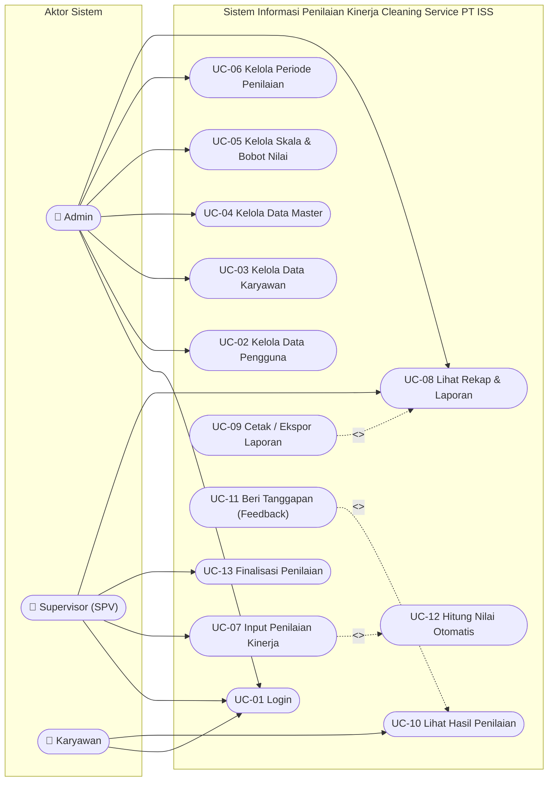

> **File PlantUML untuk Enterprise Architect:**  
> [01_use_case_diagram.puml](file:///c:/Users/lenov/.gemini/antigravity-ide/scratch/dfd-pt-iss/plantuml/01_use_case_diagram.puml)

---

### 2.3 RINCIAN USE CASE INPUT PENILAIAN KINERJA (GAMBAR 3.2)

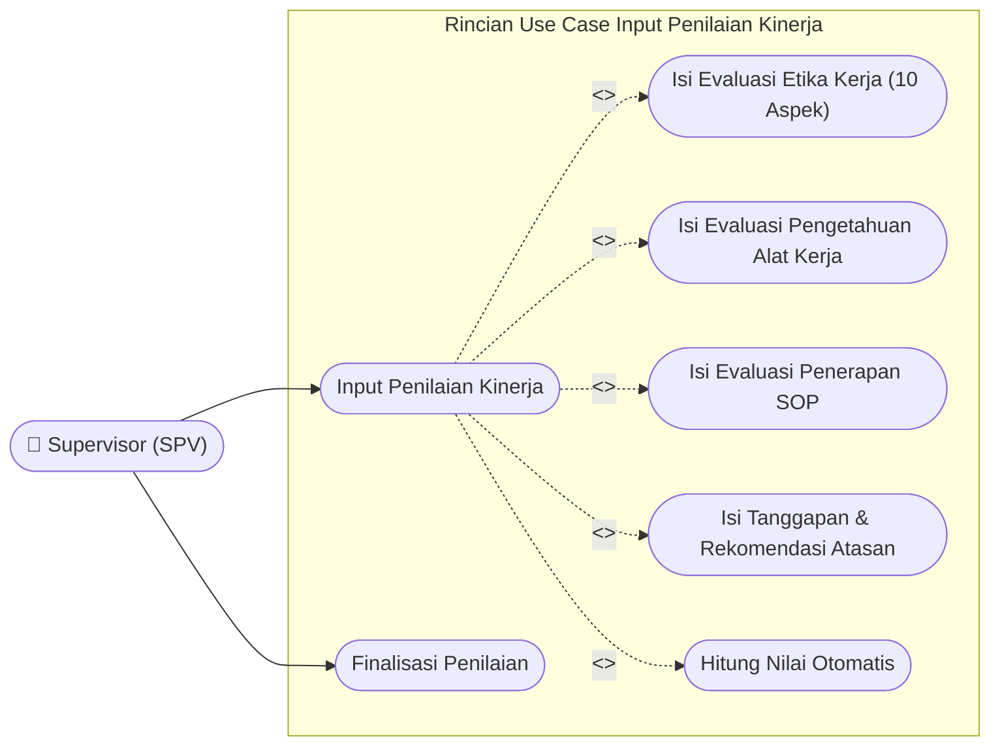

> **File PlantUML untuk Enterprise Architect:**  
> [02_rincian_use_case_input_penilaian.puml](file:///c:/Users/lenov/.gemini/antigravity-ide/scratch/dfd-pt-iss/plantuml/02_rincian_use_case_input_penilaian.puml)

---

## 3. ACTIVITY DIAGRAM (1 USE CASE = 1 ACTIVITY)

Sesuai prinsip perancangan UML standar dan kebutuhan spesifikasi sistem, setiap Use Case yang terdapat pada Use Case Diagram utama dimodelkan ke dalam **1 Activity Diagram tersendiri** (total 13 Activity Diagram). Setiap diagram menggunakan partisi jalur (*swimlane*) untuk memisahkan tanggung jawab antara **Aktor Pengguna** dan **Sistem**.

---

### 3.1 ACTIVITY DIAGRAM LOGIN (GAMBAR 3.3)
* **Use Case Terkait:** UC-01 Login
* **Aktor:** Pengguna (Admin / Supervisor / Karyawan)
* **Deskripsi:** Memvalidasi kredensial pengguna, mendeteksi hak akses (*role*), dan mengarahkan ke dashboard utama yang sesuai.

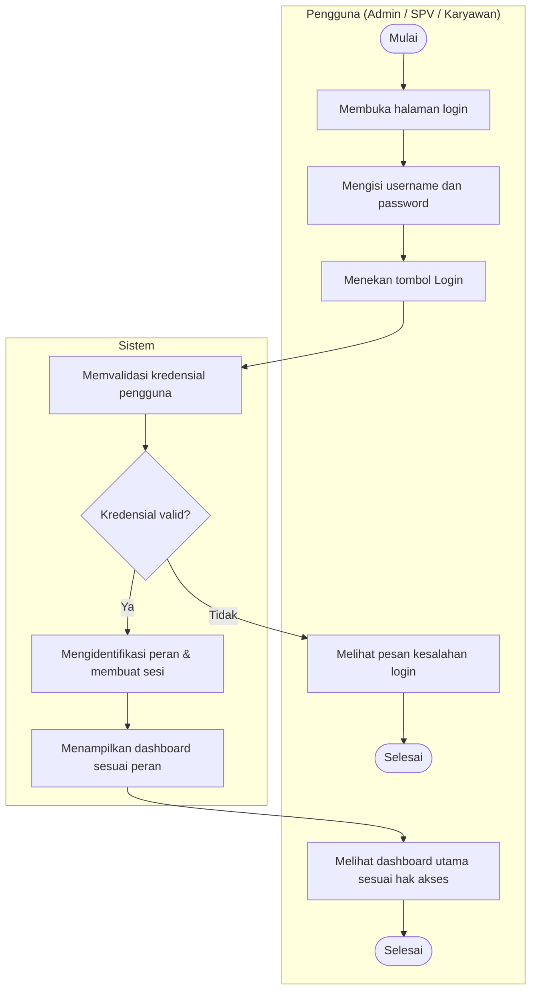
> **File PlantUML:** [act_01_login.puml](file:///c:/Users/lenov/.gemini/antigravity-ide/scratch/dfd-pt-iss/plantuml/act_01_login.puml)

---

### 3.2 ACTIVITY DIAGRAM KELOLA DATA PENGGUNA (GAMBAR 3.4)
* **Use Case Terkait:** UC-02 Kelola Data Pengguna
* **Aktor:** Admin
* **Deskripsi:** Admin mengelola akun login pengguna sistem (tambah akun, ubah profil/role, reset password, atau nonaktifkan akun).

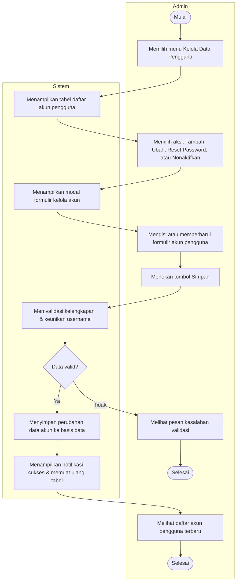
> **File PlantUML:** [act_02_kelola_pengguna.puml](file:///c:/Users/lenov/.gemini/antigravity-ide/scratch/dfd-pt-iss/plantuml/act_02_kelola_pengguna.puml)

---

### 3.3 ACTIVITY DIAGRAM KELOLA DATA KARYAWAN (GAMBAR 3.5)
* **Use Case Terkait:** UC-03 Kelola Data Karyawan
* **Aktor:** Admin
* **Deskripsi:** Admin mendaftarkan manpower cleaning service, memperbarui penempatan gedung/area kerja, atau menghapus/menonaktifkan data karyawan.

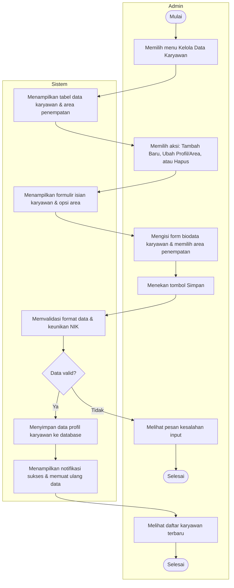
> **File PlantUML:** [act_03_kelola_karyawan.puml](file:///c:/Users/lenov/.gemini/antigravity-ide/scratch/dfd-pt-iss/plantuml/act_03_kelola_karyawan.puml)

---

### 3.4 ACTIVITY DIAGRAM KELOLA DATA MASTER (AREA, ETIKA, ALAT KERJA, SOP) (GAMBAR 3.6)
* **Use Case Terkait:** UC-04 Kelola Data Master
* **Aktor:** Admin
* **Deskripsi:** Admin memelihara data referensi master: area penempatan (gedung PEMDA), 10 indikator etika kerja, mesin/peralatan kerja, dan SOP pembersihan.

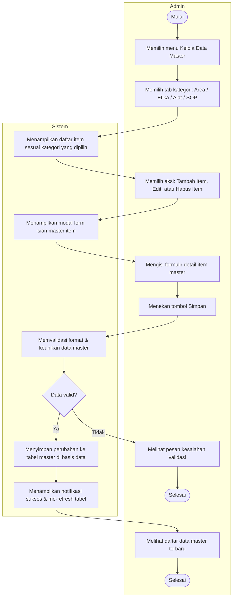
> **File PlantUML:** [act_04_kelola_master.puml](file:///c:/Users/lenov/.gemini/antigravity-ide/scratch/dfd-pt-iss/plantuml/act_04_kelola_master.puml)

---

### 3.5 ACTIVITY DIAGRAM KELOLA SKALA, BOBOT, DAN KATEGORI NILAI (GAMBAR 3.7)
* **Use Case Terkait:** UC-05 Kelola Skala, Bobot, & Kategori Nilai
* **Aktor:** Admin
* **Deskripsi:** Mengatur bobot persentase evaluasi (Etika 30%, Alat 35%, SOP 35%), skala nilai huruf/angka, dan ambang batas predikat kualitatif.

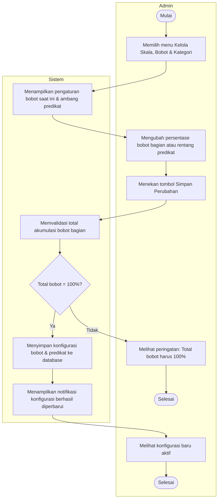
> **File PlantUML:** [act_05_kelola_skala_bobot.puml](file:///c:/Users/lenov/.gemini/antigravity-ide/scratch/dfd-pt-iss/plantuml/act_05_kelola_skala_bobot.puml)

---

### 3.6 ACTIVITY DIAGRAM KELOLA PERIODE PENILAIAN (GAMBAR 3.8)
* **Use Case Terkait:** UC-06 Kelola Periode Penilaian
* **Aktor:** Admin
* **Deskripsi:** Admin membuka periode evaluasi bulanan yang baru, mengatur rentang waktu penilaian, atau menutup periode yang telah selesai.

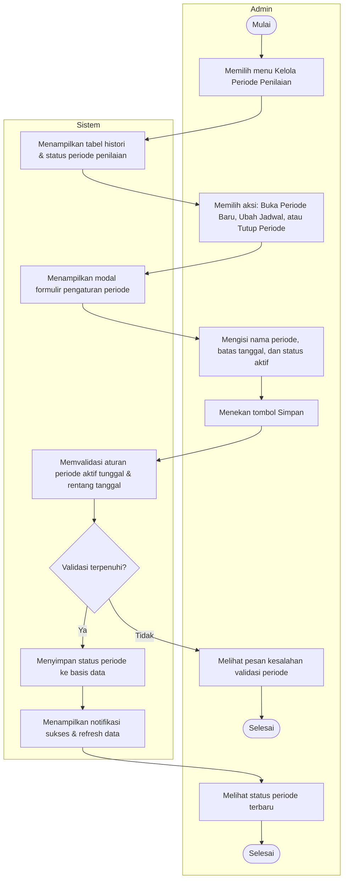
> **File PlantUML:** [act_06_kelola_periode.puml](file:///c:/Users/lenov/.gemini/antigravity-ide/scratch/dfd-pt-iss/plantuml/act_06_kelola_periode.puml)

---

### 3.7 ACTIVITY DIAGRAM INPUT PENILAIAN KINERJA (GAMBAR 3.9)
* **Use Case Terkait:** UC-07 Input Penilaian Kinerja
* **Aktor:** Supervisor (SPV)
* **Deskripsi:** SPV mengisi skor instrumen penilaian 3 aspek (Etika, Alat, SOP) beserta catatan rekomendasi atasan, kemudian menyimpannya sebagai DRAFT.

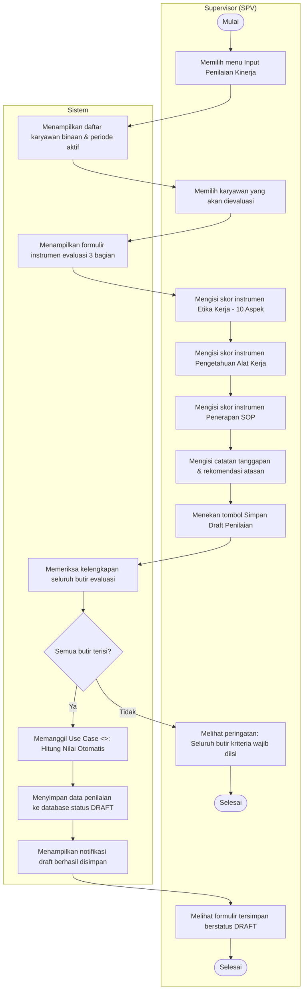
> **File PlantUML:** [act_07_input_penilaian.puml](file:///c:/Users/lenov/.gemini/antigravity-ide/scratch/dfd-pt-iss/plantuml/act_07_input_penilaian.puml)

---

### 3.8 ACTIVITY DIAGRAM HITUNG NILAI OTOMATIS (INCLUDE) (GAMBAR 3.10)
* **Use Case Terkait:** UC-08 Hitung Nilai Otomatis (Relasi `<<include>>` dari UC-07)
* **Aktor:** Sistem (Modul Perhitungan Penilaian)
* **Deskripsi:** Sub-alur yang otomatis dieksekusi saat data penilaian disimpan untuk menghitung rata-rata bagian, mengalikan bobot tertimbang, dan memetakan predikat kualitatif.

```mermaid
flowchart TD
    subgraph Sistem["Sistem (Modul Perhitungan Penilaian)"]
        A([Mulai: Dipanggil oleh Form Penilaian]) --> B[Menerima input skor Etika, Alat, dan SOP]
        B --> C[Mengambil parameter bobot dari tabel konfigurasi]
        C --> D[Menghitung rata-rata skor per bagian]
        D --> E["Menghitung Nilai Akhir Tertimbang:\n(Etika x 30%) + (Alat x 35%) + (SOP x 35%)"]
        E --> F[Mencocokkan Nilai Akhir ke tabel ambang predikat kualitatif]
        F --> G[Menetapkan kategori nilai: Sangat Baik / Baik / Cukup / Kurang]
        G --> H[Menyimpan hasil kalkulasi ke record penilaian]
        H --> I[Mengembalikan nilai kalkulasi ke antarmuka formulir]
        I --> J([Selesai])
    end
```
> **File PlantUML:** [act_08_hitung_nilai_otomatis.puml](file:///c:/Users/lenov/.gemini/antigravity-ide/scratch/dfd-pt-iss/plantuml/act_08_hitung_nilai_otomatis.puml)

---

### 3.9 ACTIVITY DIAGRAM FINALISASI PENILAIAN (GAMBAR 3.11)
* **Use Case Terkait:** UC-09 Finalisasi Penilaian
* **Aktor:** Supervisor (SPV)
* **Deskripsi:** Mengunci data penilaian dari status DRAFT menjadi FINAL sehingga nilai sah, terkunci dari manipulasi, dan otomatis dipublikasikan ke karyawan terkait.

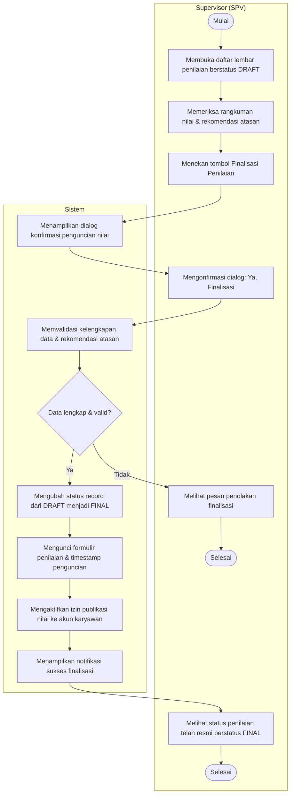
> **File PlantUML:** [act_09_finalisasi_penilaian.puml](file:///c:/Users/lenov/.gemini/antigravity-ide/scratch/dfd-pt-iss/plantuml/act_09_finalisasi_penilaian.puml)

---

### 3.10 ACTIVITY DIAGRAM LIHAT REKAP DAN LAPORAN PENILAIAN (GAMBAR 3.12)
* **Use Case Terkait:** UC-10 Lihat Rekap & Laporan Penilaian
* **Aktor:** Admin / Supervisor (SPV)
* **Deskripsi:** Pengguna menyaring data nilai berdasarkan periode, gedung/area, dan kategori skor untuk memantau rekapitulasi performa seluruh manpower.

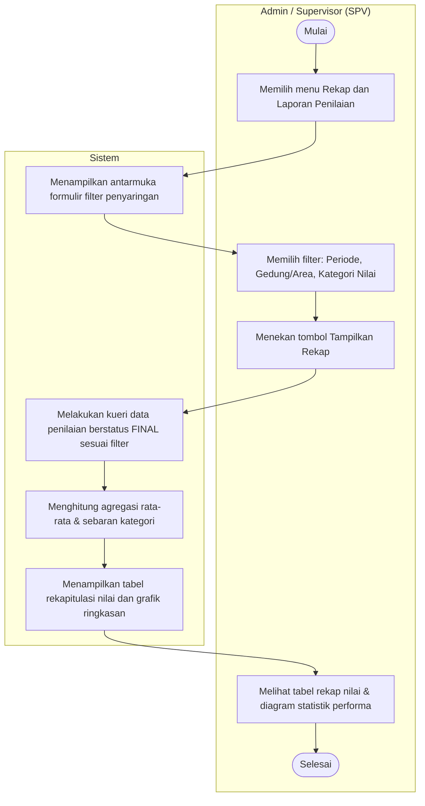
> **File PlantUML:** [act_10_rekap_laporan.puml](file:///c:/Users/lenov/.gemini/antigravity-ide/scratch/dfd-pt-iss/plantuml/act_10_rekap_laporan.puml)

---

### 3.11 ACTIVITY DIAGRAM CETAK / EKSPOR LAPORAN (EXTEND) (GAMBAR 3.13)
* **Use Case Terkait:** UC-11 Cetak / Ekspor Laporan (Relasi `<<extend>>` dari UC-10)
* **Aktor:** Admin / Supervisor (SPV)
* **Deskripsi:** Mengunduh berkas laporan hasil penilaian kinerja karyawan ke dalam format PDF resmi ber-kop perusahaan atau lembar kerja Excel.

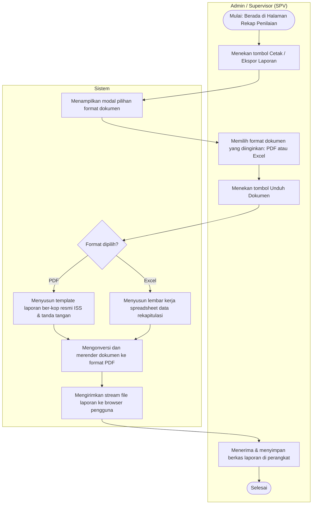
> **File PlantUML:** [act_11_cetak_ekspor_laporan.puml](file:///c:/Users/lenov/.gemini/antigravity-ide/scratch/dfd-pt-iss/plantuml/act_11_cetak_ekspor_laporan.puml)

---

### 3.12 ACTIVITY DIAGRAM LIHAT HASIL PENILAIAN (GAMBAR 3.14)
* **Use Case Terkait:** UC-12 Lihat Hasil Penilaian
* **Aktor:** Karyawan
* **Deskripsi:** Karyawan melihat lembar evaluasi hasil kinerja miliknya sendiri yang berstatus FINAL beserta catatan pembinaan dan rekomendasi supervisor.

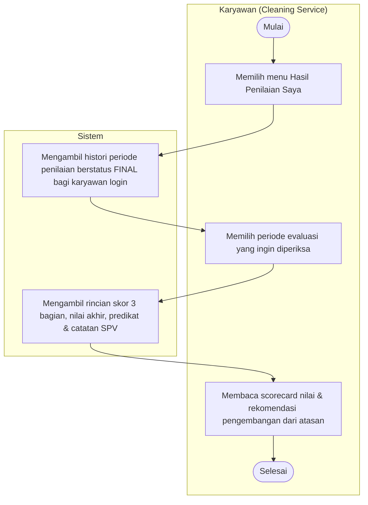
> **File PlantUML:** [act_12_lihat_hasil_penilaian.puml](file:///c:/Users/lenov/.gemini/antigravity-ide/scratch/dfd-pt-iss/plantuml/act_12_lihat_hasil_penilaian.puml)

---

### 3.13 ACTIVITY DIAGRAM BERI TANGGAPAN (FEEDBACK) (EXTEND) (GAMBAR 3.15)
* **Use Case Terkait:** UC-13 Beri Tanggapan (Feedback) (Relasi `<<extend>>` dari UC-12)
* **Aktor:** Karyawan
* **Deskripsi:** Karyawan memberikan respon tertulis atau klarifikasi resmi atas hasil penilaian yang diterimanya, tersimpan secara permanen pada sistem.

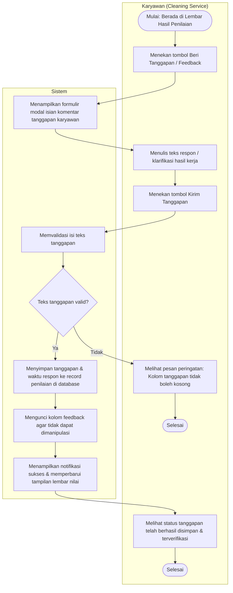
> **File PlantUML:** [act_13_beri_tanggapan_feedback.puml](file:///c:/Users/lenov/.gemini/antigravity-ide/scratch/dfd-pt-iss/plantuml/act_13_beri_tanggapan_feedback.puml)

---

---

## 4. CLASS DIAGRAM (GAMBAR 3.8)

### 4.1 DIAGRAM STRUKTUR KELAS
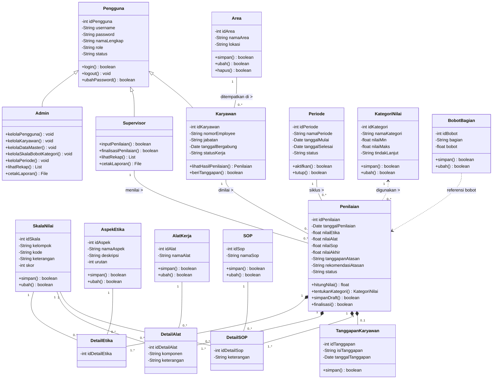
> **File PlantUML:** [08_class_diagram.puml](file:///c:/Users/lenov/.gemini/antigravity-ide/scratch/dfd-pt-iss/plantuml/08_class_diagram.puml)

---

## 5. ENTITY RELATIONSHIP DIAGRAM / ERD (GAMBAR 3.9)

### 5.1 DIAGRAM RELASI ENTITAS (CROW'S FOOT NOTATION)
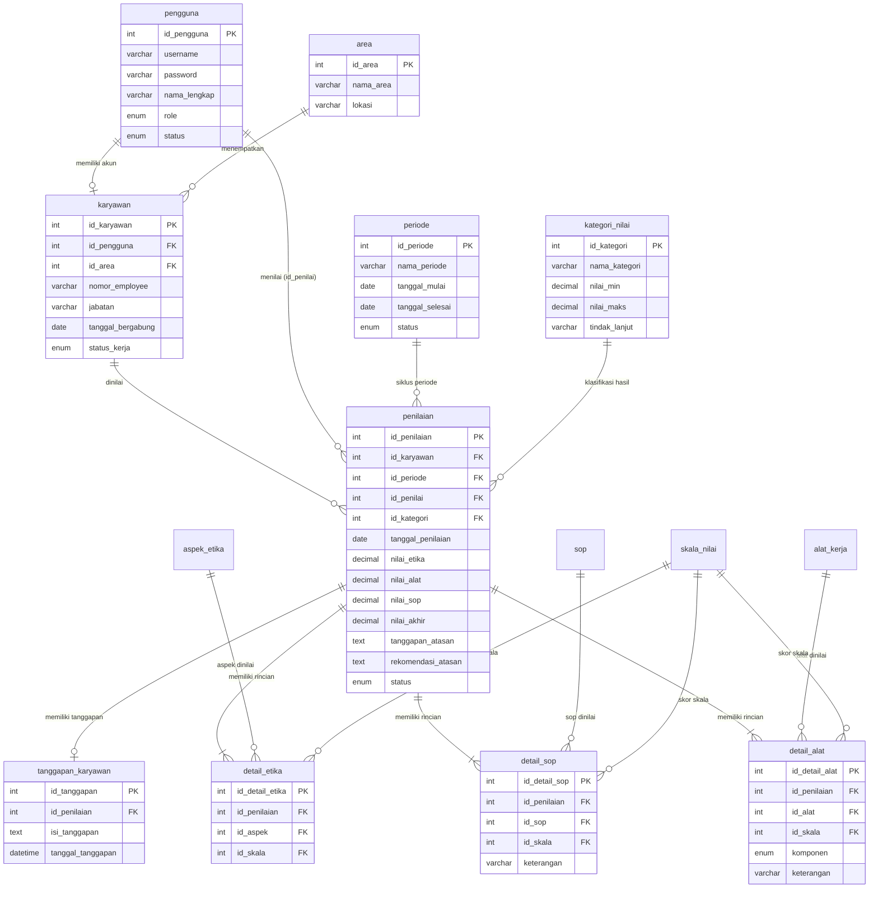
> **File DDL SQL untuk EA:** [schema_erd_enterprise_architect.sql](file:///c:/Users/lenov/.gemini/antigravity-ide/scratch/dfd-pt-iss/schema_erd_enterprise_architect.sql)  
> **File PlantUML:** [09_erd_database.puml](file:///c:/Users/lenov/.gemini/antigravity-ide/scratch/dfd-pt-iss/plantuml/09_erd_database.puml)

---

## 6. SEQUENCE DIAGRAM

### 6.1 SEQUENCE DIAGRAM LOGIN (GAMBAR 3.10)
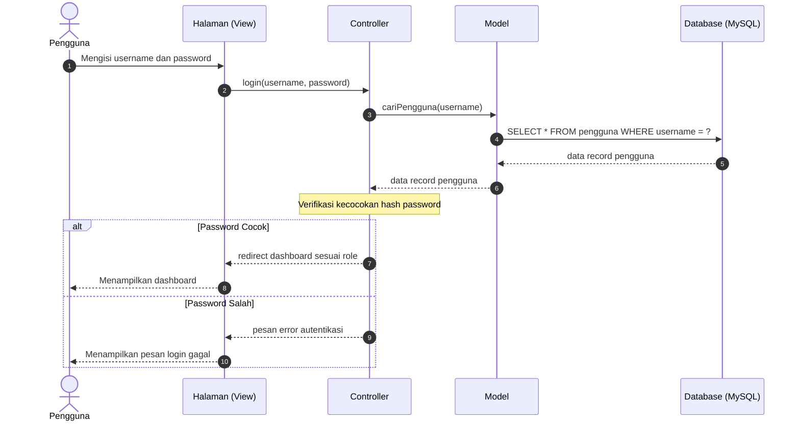
> **File PlantUML:** [10_sequence_login.puml](file:///c:/Users/lenov/.gemini/antigravity-ide/scratch/dfd-pt-iss/plantuml/10_sequence_login.puml)

---

### 6.2 SEQUENCE DIAGRAM KELOLA DATA KARYAWAN (GAMBAR 3.11)
```mermaid
sequenceDiagram
    autonumber
    actor Admin as Admin
    participant View as Halaman (View)
    participant Ctrl as Controller
    participant Model as Model
    participant DB as Database (MySQL)

    Admin->>View: Memilih menu Data Karyawan
    View->>Ctrl: index()
    Ctrl->>Model: ambilSemuaKaryawan()
    Model->>DB: SELECT karyawan JOIN pengguna, area
    DB-->>Model: data daftar karyawan
    Model-->>Ctrl: data daftar karyawan
    Ctrl-->>View: render tabel karyawan
    View-->>Admin: Menampilkan daftar karyawan

    Admin->>View: Mengisi form data baru lalu Simpan
    View->>Ctrl: simpan(data)
    Note over Ctrl: Validasi format data & integritas

    alt Data Valid
        Ctrl->>Model: buatAkun() & simpanKaryawan()
        Model->>DB: INSERT INTO pengguna; INSERT INTO karyawan;
        DB-->>Model: status berhasil
        Model-->>Ctrl: status berhasil
        Ctrl-->>View: pesan sukses data tersimpan
        View-->>Admin: Menampilkan daftar terbaru
    else Data Tidak Valid
        Ctrl-->>View: pesan validasi error
        View-->>Admin: Menampilkan pesan perbaikan
    end
```
> **File PlantUML:** [11_sequence_kelola_karyawan.puml](file:///c:/Users/lenov/.gemini/antigravity-ide/scratch/dfd-pt-iss/plantuml/11_sequence_kelola_karyawan.puml)

---

### 6.3 SEQUENCE DIAGRAM INPUT PENILAIAN KINERJA (GAMBAR 3.12)
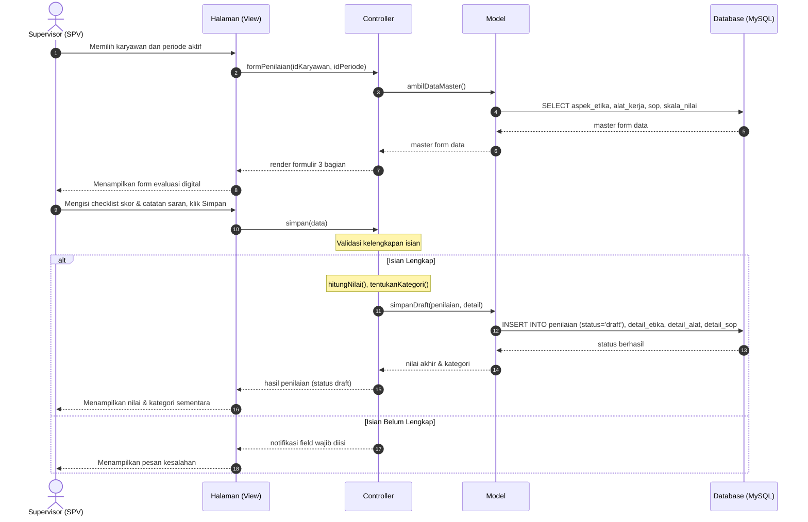
> **File PlantUML:** [12_sequence_input_penilaian.puml](file:///c:/Users/lenov/.gemini/antigravity-ide/scratch/dfd-pt-iss/plantuml/12_sequence_input_penilaian.puml)

---

### 6.4 SEQUENCE DIAGRAM FINALISASI PENILAIAN (GAMBAR 3.13)
```mermaid
sequenceDiagram
    autonumber
    actor SPV as Supervisor (SPV)
    participant View as Halaman (View)
    participant Ctrl as Controller
    participant Model as Model
    participant DB as Database (MySQL)

    SPV->>View: Menekan tombol Finalisasi Penilaian
    View->>Ctrl: finalisasi(idPenilaian)
    Ctrl->>Model: ubahStatus("final")
    Model->>DB: UPDATE penilaian SET status = 'final' WHERE id_penilaian = ?
    DB-->>Model: status berhasil diubah
    Model-->>Ctrl: status berhasil
    Ctrl-->>View: status final (terkunci)
    View-->>SPV: Menampilkan konfirmasi penilaian terkunci resmi
```
> **File PlantUML:** [13_sequence_finalisasi_penilaian.puml](file:///c:/Users/lenov/.gemini/antigravity-ide/scratch/dfd-pt-iss/plantuml/13_sequence_finalisasi_penilaian.puml)

---

### 6.5 SEQUENCE DIAGRAM LIHAT HASIL & BERI TANGGAPAN (GAMBAR 3.14)
```mermaid
sequenceDiagram
    autonumber
    actor Karyawan as Karyawan
    participant View as Halaman (View)
    participant Ctrl as Controller
    participant Model as Model
    participant DB as Database (MySQL)

    Karyawan->>View: Memilih periode penilaian
    View->>Ctrl: lihatHasil(idPenilaian)
    Ctrl->>Model: ambilHasil(idPenilaian, idKaryawan)
    Model->>DB: SELECT * FROM penilaian WHERE id_karyawan = ? AND status = 'final'
    DB-->>Model: data penilaian final
    Model-->>Ctrl: data penilaian final
    Ctrl-->>View: halaman hasil evaluasi
    View-->>Karyawan: Menampilkan rincian nilai & rekomendasi atasan

    Karyawan->>View: Menuliskan tanggapan/klarifikasi lalu klik Kirim
    View->>Ctrl: simpanTanggapan(idPenilaian, isiTanggapan)
    Note over Ctrl: Validasi panjang & keabsahan karakter

    alt Tanggapan Terisi
        Ctrl->>Model: simpan(tanggapan)
        Model->>DB: INSERT INTO tanggapan_karyawan (id_penilaian, isi_tanggapan)
        DB-->>Model: status berhasil
        Model-->>Ctrl: status berhasil
        Ctrl-->>View: pesan sukses tanggapan terkirim
        View-->>Karyawan: Menampilkan teks tanggapan pada dokumen nilai
    else Tanggapan Kosong
        Ctrl-->>View: peringatan teks tanggapan tidak boleh kosong
        View-->>Karyawan: Menampilkan pesan kesalahan
    end
```
> **File PlantUML:** [14_sequence_lihat_hasil_feedback.puml](file:///c:/Users/lenov/.gemini/antigravity-ide/scratch/dfd-pt-iss/plantuml/14_sequence_lihat_hasil_feedback.puml)

---

### 6.6 SEQUENCE DIAGRAM REKAP & CETAK LAPORAN (GAMBAR 3.15)
```mermaid
sequenceDiagram
    autonumber
    actor User as Admin / SPV
    participant View as Halaman (View)
    participant Ctrl as Controller
    participant Model as Model
    participant DB as Database (MySQL)

    User->>View: Menentukan filter (periode, gedung, kategori)
    View->>Ctrl: rekap(filter)
    Ctrl->>Model: ambilRekap(filter)
    Model->>DB: SELECT penilaian JOIN karyawan, periode, kategori_nilai WHERE filter
    DB-->>Model: data agregasi rekap
    Model-->>Ctrl: data agregasi rekap
    Ctrl-->>View: tabel hasil filter rekap
    View-->>User: Menampilkan rekapitulasi nilai

    User->>View: Menekan tombol Cetak / Ekspor (PDF/Excel)
    View->>Ctrl: ekspor(format, filter)
    Note over Ctrl: Merender berkas laporan PDF / Spreadsheet
    Ctrl-->>View: tautan berkas dokumen laporan
    View-->>User: Mengunduh file laporan
```
> **File PlantUML:** [15_sequence_rekap_cetak_laporan.puml](file:///c:/Users/lenov/.gemini/antigravity-ide/scratch/dfd-pt-iss/plantuml/15_sequence_rekap_cetak_laporan.puml)

---

## 7. PANDUAN INTEGRASI & PENGGUNAAN DI ENTERPRISE ARCHITECT (EA)

Untuk membuka dan mengedit langsung rancangan ini di aplikasi **Enterprise Architect (Sparx Systems)**:

### Cara 1: Menggunakan XMI 2.1 File (Sangat Direkomendasikan)
1. Buka Enterprise Architect, buat atau buka project repository Anda.
2. Pada panel **Project Browser**, klik kanan pada package root (misal `Model`).
3. Pilih menu **Import/Export** &rarr; **Import Package from XMI File...** (atau tekan shortcut `Ctrl + Alt + I`).
4. Klik **Browse** dan arahkan ke file:
   `c:\Users\lenov\.gemini\antigravity-ide\scratch\dfd-pt-iss\enterprise_architect_model.xmi`
5. Klik **Import**.
6. **Hasil:** Enterprise Architect akan otomatis membentuk paket:
   - `01 Use Case Model` (Lengkap dengan 3 Aktor dan 17 Use Case + relasi include/extend)
   - `02 Class Model` (Lengkap dengan 17 Kelas, atribut tipe data, method visibilitas, inheritance, dan kardinalitas)
   - `03 Activity Model` (Alur aktivitas kerja)
   - `04 Sequence Model` (Kolaborasi interaksi, Lifeline, dan Message)
   - `05 Data Model (ERD)` (Tabel entitas data relasional)

### Cara 2: Menghasilkan ERD Lengkap via DDL SQL di Enterprise Architect
1. Di Enterprise Architect, buka ribbon tab **Develop** &rarr; **Data Modeling**.
2. Klik tombol **Import DB Schema from SQL DDL**.
3. Pilih Database Type: **MySQL**.
4. Pilih file:
   `c:\Users\lenov\.gemini\antigravity-ide\scratch\dfd-pt-iss\schema_erd_enterprise_architect.sql`
5. Centang *Prompt on duplicate table* & klik **Import**.
6. EA akan merender seluruh tabel, relasi Foreign Key, Primary Key, dan tipe data kolom ke diagram Data Modeling EA.

---

## 8. ATURAN DAN ASUMSI RANCANGAN

1. **Integritas Penilaian per Periode:** Satu karyawan hanya memiliki **1 (satu)** catatan penilaian pada satu periode evaluasi (kombinasi `id_karyawan` dan `id_periode` bersifat unik / `UNIQUE constraint`).
2. **Siklus Status Draft dan Final:** Penilaian yang baru diinput SPV berstatus `draft`. Karyawan hanya diperbolehkan melihat penilaian jika statusnya sudah diubah menjadi `final` oleh SPV. Setelah berstatus `final`, data penilaian terkunci dan tidak dapat disunting kembali oleh SPV demi integritas nilai.
3. **Klarifikasi Karyawan (Feedback):** Satu penilaian hanya memiliki 1 catatan tanggapan karyawan, merefleksikan kolom tanda tangan dan kolom tanggapan pada lembar kertas Evaluasi Berkala PT ISS.
4. **Fleksibilitas Bobot & Skala:** Pembobotan persentase (Etika 30%, Alat 35%, SOP 35%) dan ambang batas predikat disimpan dalam tabel konfigurasi (`bobot_bagian`, `skala_nilai`, `kategori_nilai`) agar dapat disesuaikan kebijakan manajemen ISS tanpa merubah struktur kode program.
5. **Dekomposisi Penilaian Alat:** Tabel `detail_alat` mencatat penilaian per mesin per 3 komponen utama (Fungsi, Penggunaan, dan Perawatan) sesuai lembar evaluasi operasional ISS di lingkungan PEMDA Tangsel.
